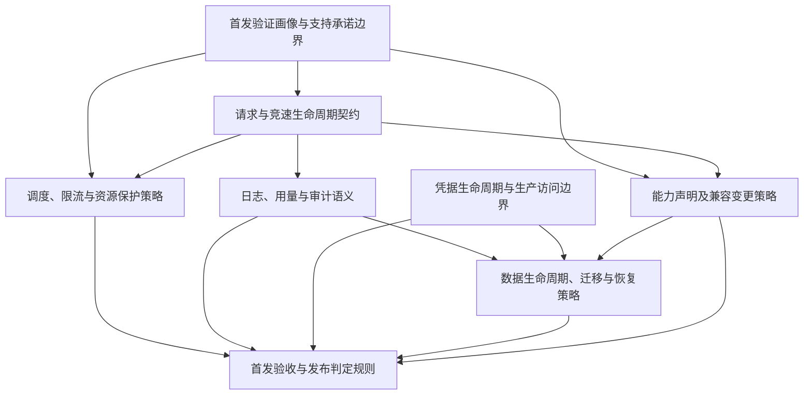

# 确定首发验证画像与支持承诺边界

## Problem Statement

运营方已经拥有 NVIDIA2API 的需求与概要设计草案，但尚未明确首发要验证哪些真实调用场景，以及在什么环境和负载下验证。模型、客户端、能力、容量目标和部署条件仍有待确认输入，后续设计者容易自行补全假设，使兼容声明、资源设计和验收标准彼此不一致。

现有接口和测试证明项目具备继续验证的入口，不代表目标 NVIDIA 模型、客户端组合或生产容量已经通过验证。当前实现中的统一参数白名单和流式用量请求行为，也不能直接作为逐模型能力支持的证据。

本规格承接当前讨论推荐的第一个 wayfinder 目标。该目标尚未经过运营方正式批准；本规格用于指导澄清和记录决策，不代替运营方选择模型、客户端、负载或生产配置。

## Solution

形成一份可评审、可追踪的首发验证画像，明确受控调用方、典型调用场景、代表性 NVIDIA 模型、客户端及版本、必要能力、目标部署环境、负载画像和证据要求。

画像将“准备验证的目标”与“已经验证的支持承诺”分别记录。后续团队能够据此制定详细契约、选择实验样本和规划验收，不再猜测服务对象或运行条件。尚未取得的输入必须明确列出责任方、影响和解除阻塞条件。

本目标结束于验证范围和支持声明规则清晰、可交接，不要求完成全部功能开发或真实兼容、压力和恢复测试。不因本目标选取少量代表性场景而缩减 SRS 的首发功能范围。

## User Stories

1. 作为服务运营方，我希望明确首发受控调用方和访问方式，以便后续设计围绕真实使用者展开。
2. 作为服务运营方，我希望描述代表性业务调用场景，以便区分必须满足的行为和仅供调查的候选能力。
3. 作为调用方，我希望看到准备验证的 SDK 或客户端名称、版本和调用方式，以便判断我的集成是否在目标范围内。
4. 作为服务运营方，我希望选择代表性 NVIDIA 模型及可获得的版本、区域或访问条件，以便验证具有可复现的对象。
5. 作为验证人员，我希望每个必验组合都关联具体场景，以便避免机械地测试全部模型、客户端和能力的笛卡尔积。
6. 作为调用方，我希望常规文本、非流式和 SSE 场景在画像中明确列出，以便理解核心 API 的验证基线。
7. 作为产品负责人，我希望工具调用、JSON 输出、采样参数、token 上限和流式 usage 等候选能力都有明确分类，以便未决能力不会被默认视为已支持。
8. 作为调用方，我希望不支持或无效参数的预期处理被记录为接受、拒绝、忽略或待决定，以便后续契约不会出现隐含行为。
9. 作为维护者，我希望每个目标组合分别记录选择原因、验证状态和行为结论，以便区分产品优先级与实际兼容性。
10. 作为调用方，我希望只有具有对应验证证据的组合才能标记为已支持，以便兼容声明可信。
11. 作为验证人员，我希望模拟测试和真实 NVIDIA/代理验证的证据类型明确区分，以便不将内部测试误当作外部兼容证明。
12. 作为部署方，我希望记录目标主机规格、持久化条件、网络入口及代理路径，以便后续容量和部署验证有一致前提。
13. 作为运维人员，我希望目标拓扑明确保持单个后端 worker 和 SQLite 单实例，以便容量目标不依赖当前不支持的扩展方式。
14. 作为服务运营方，我希望描述典型与峰值负载、短请求与长流比例以及输入输出规模，以便资源设计具有负载依据。
15. 作为服务运营方，我希望对并发、请求量、延迟、错误率和可用性目标记录适用场景、统计口径及批准状态，以便未经批准的数字不会成为生产承诺。
16. 作为资源设计人员，我希望区分负载目标、资源配置候选值和实测结论，以便避免通过调整目标来掩盖配置或容量问题。
17. 作为运维人员，我希望记录可用 Key、上游配额、代理协议和真实测试时段等前提，以便判断验证是否具备条件。
18. 作为凭据管理员，我希望画像只引用受控凭据的用途、保管位置标识和责任方，以便评审文档不泄漏秘密值。
19. 作为项目负责人，我希望每个缺失输入都有责任方、下游影响和关闭条件，以便未决事项可继续推进。
20. 作为项目负责人，我希望首发画像与相关 SRS 要求及 TBD 输入关联，以便目标选择可追溯而不改写需求范围。
21. 作为后续设计者，我希望知道哪些问题已经明确、哪些需要单独的决策票，以便继续清除迷雾而不是猜测答案。
22. 作为项目负责人，我希望看到候选目标之间的依赖关系，以便安排可并行的决策工作。
23. 作为运营方，我希望画像的审批记录与后续验证证据分别维护，以便批准测试目标不会被解释为测试已经通过。
24. 作为维护者，我希望模型、客户端或环境变化后能识别受影响的支持声明，以便后续兼容变更策略具有明确输入。
25. 作为验收人员，我希望获得一个不依赖未说明假设的交接材料，以便后续可以编写可执行的验证计划。

## Implementation Decisions

- **交付性质**：这是规划与决策规格。主要交付物是首发验证画像及关联决策索引，不是业务功能实现，也不在本规格中建立可运行的模型能力管理系统。
- **沿用架构约束**：Django/DRF、Next.js、SQLite 单实例、一个后端 worker、管理员自托管及受控调用方作为本次规划前提。扩大这些边界须另行决策。
- **需求权威**：SRS 定义首发范围与验收要求，HLD 提供设计前提，FSR 用于理解风险和验证顺序。FSR 的分阶段建议不改变 SRS 首发范围。
- **术语**：沿用 NVIDIA Key、用户 API Key、Route、Direct Route、竞速、Winner、模型能力矩阵和受控调用方等现有术语。“首发验证画像”表示准备验证的场景与环境集合；“支持承诺”表示由对应证据支撑的对外声明。
- **范围登记**：每个必验组合关联场景、模型标识、客户端及版本、调用方式、能力、预期结果、优先级、选择原因和证据要求。不默认要求所有维度的全组合验证。
- **核心基线**：常规文本、非流式、SSE、模型发现与授权、OpenAI 风格错误列为目标讨论的核心基线。具体模型和客户端清单由运营方批准，不能由代理编造。
- **能力分类**：每项能力分别记录需求属性、验证状态和参数行为。需求属性可为必需或候选；验证状态区分未验证、已通过、未通过和外部条件阻塞；参数行为区分接受、拒绝、忽略和待决定。忽略参数不等于支持其功能。
- **目标与证据分离**：已批准的必验组合不等于已支持组合。标记已通过须引用对应模型、客户端版本、参数、环境、时间和结果证据；模拟上游结果不能单独证明真实 NVIDIA 兼容性。
- **环境登记**：记录目标主机资源、单 worker 拓扑、SQLite 存储条件、TLS 入口、管理网络边界、Next.js 到后端路径和代理协议。尚未确定的安全或恢复细节转交相应目标，不在此假设已经解决。
- **负载登记**：记录典型及峰值并发或请求量、流式占比、流持续时间、输入输出规模、模型分布和可用上游配额。延迟、错误率和可用性等目标须注明统计口径、适用条件、测量窗口及批准状态。
- **资源值分层**：容量目标与请求体、并发、线路数、连接池及超时配置值分别记录。资源配置允许保留为后续决策输入；本规格不凭空指定部署值或宣称容量达标。
- **秘密引用**：只登记真实验证所需的凭据类别、受控保管位置标识、责任方和可用条件。画像、工单、日志及证据不包含密钥、token 或代理密码全文。
- **TBD 追踪**：重点澄清 TBD-01、TBD-02、TBD-04 的目标输入，界定 TBD-03、TBD-05、TBD-09 至 TBD-11 的依赖。TBD-06 至 TBD-08 保留为后续数据、安全与恢复目标的输入；任何 TBD 只有满足原有关闭条件才能关闭，不能因填写目标而视为验收完成。
- **决策权**：运营方选择业务目标并批准画像；代理负责查证仓库事实、组织选项和标明缺口。外部资料调查与真实测试安排在需要时另行开展，不以本规格代替其结论。
- **不新增运行接口**：本目标不新增 API、数据库表、生产配置或前端页面。未来是否将画像转为运行时能力矩阵，由后续目标决定。
- **地图与实施工单区分**：本规格作为实施澄清工作的普通规格工单，使用 `ready-for-agent`。如果随后建立 wayfinder 地图，地图及决策票仅使用对应 `wayfinder:` 标签，不将该规格工单兼作地图或决策票。
- **完成条件**：目标场景、必验组合及目标环境和负载输入已由相应责任方确认；每个组合有预期行为或关联的明确决策问题；后续团队可以据此编写验证计划。缺失的目标选择或批准仍是本目标的阻塞，不能仅移入附注后宣布完成。
- **交接边界**：允许外部凭据、实际兼容证据、压测或恢复演练仍待获取，但须明确阻塞其验证的条件及责任方，并保持“未验证”状态。

## Testing Decisions

- **首要验收边界为画像整体**：按运营方与后续设计者能否据此选择样本、制定预期结果和识别阻塞进行评审，避免测试文档内部排版或实现细节。
- **待确认的验证边界**：本目标采用文档与需求追踪评审；后续兼容验证优先从现有 `/v1/models` 和 `/v1/chat/completions` HTTP 入口检验外部行为。该边界方案须在发布规格前向用户核对，目前尚未获用户确认。
- **完整性检查**：每个必验组合都能定位场景、模型、客户端版本、能力、预期行为和证据要求；无法确定的项明确标记待决，不填写猜测值。
- **一致性检查**：画像不改变单 worker、SQLite 和受控调用方边界，不把代表性场景选择当作缩减首发功能范围，不将未知能力、用量或容量描述为已验证。
- **状态检查**：目标已批准但尚无真实测试证据的组合必须保持未验证；外部凭据或额度不足应标记阻塞；失败证据不能被目标批准覆盖。
- **追踪检查**：相关 SRS/TBD 均有映射，且目标输入确认与测试、演练通过分别可追踪。首发需求不能因未进入本地图而丢失。
- **反例走查**：至少检查未验证的工具调用、与已测版本不同的客户端、仅有模拟上游的 SSE 测试、缺少额度的真实验证，以及尚未完成压测的批准负载目标，确认它们不会被误标为支持或通过。
- **现有测试先例**：现有 Django HTTP 入口测试已覆盖模型权限过滤、非流式成功与错误、流式全失败状态和 SSE 返回，可为后续外部行为测试提供先例；竞速和线路测试可提供故障注入素材，但不能取代真实兼容证据。
- **测试投入**：本次仅形成规划材料，无运行逻辑变更，不新增自动化测试、不要求运行后端或前端全套测试。真实 SDK/NVIDIA/代理兼容测试、压力测试与恢复演练属于后续验证工作。

## Out of Scope

- 实现或修复竞速引擎、RPM 原子领取、流式资源清理、连接池或并发控制。
- 最终裁定所有 Winner 有效输出边界、流中断语义和计数规则；这些属于请求与竞速生命周期契约目标。
- 开发模型能力矩阵、代理分组、独立用量、审计、Dashboard 或管理页面。
- 确定全部数据库字段、索引、删除策略或迁移实现。
- 完成凭据加密、轮换、生产配置、TLS、保留清理和备份恢复实现。
- 执行全部真实兼容测试、压测、真实上游冒烟及恢复演练，或据此宣布首发可以发布。
- 凭空指定模型、SDK 版本、负载、容量/SLO、资源限制、保留期、恢复目标或密钥轮换周期。
- 多 worker、多实例、高可用、公众 SaaS、多租户、数据库迁移、多 Provider 和账单硬封顶。
- 未经另行授权创建完整 wayfinder 地图、批量决策票或启动并行研究任务。

## Further Notes

本规格依据本次讨论中的首个目标建议，以及 HLD、SRS、FSR 和现有 OpenAI API 入口及测试的静态阅读。没有执行真实 NVIDIA/代理调用或容量验证；运营方尚未批准具体模型、客户端和目标负载。

候选目标依赖如下。箭头表示前者的决策结论是后者最终定稿的输入，不禁止提前调查。该图是规划建议，不代表已建立工单关系或批准了全部目标。

凭据生命周期与生产访问边界可以并行推进。请求与竞速生命周期契约是本目标之后建议优先澄清的领域，重点包括角色 delta、工具调用片段等输出是否有效，Winner 与请求最终成功如何区分，可用 NVIDIA Key 的定义，以及 Winner 用量与其他线路可能消耗额度的区别。

发布目标为本项目 GitLab Issues，标签为 `ready-for-agent`。本地规格保存不等于已发布；发布状态以实际工单链接为准。
