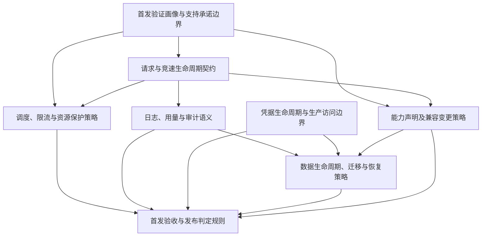

# 首发验证画像与交接记录

## 文档状态

| 项目 | 当前记录 |
|---|---|
| 版本 | 草案 0.1 |
| 更新日期 | 2026-10-24 |
| 画像批准 | 未批准；等待服务运营方确认场景、模型、客户端和负载目标 |
| 部署环境批准 | 未批准；等待部署方确认主机、入口、网络边界和真实验证条件 |
| 验证状态 | 本文没有记录任何真实 NVIDIA、代理或容量测试通过结果 |
| 完成判定 | 阻塞；未决目标选择和责任方批准不能用假设代替 |

本文是供运营方、部署方和验证人员评审的目标登记与交接记录，不是运行时能力矩阵、生产配置或测试报告。选择某个组合表示“准备验证”，不表示该组合已通过、已支持或可以对外承诺。本画像不缩减 [SRS](../srs.md) 的首发范围，也不代表首发可发布。

## 记录规则

- **目标批准**：只有对应责任方明确确认后，目标状态才可改为“已批准”；批准目标不能改变验证状态。
- **验证状态**：每个目标组合单独标记“未验证”“已通过”“未通过”或“外部条件阻塞”。没有可追溯证据不得标记“已通过”。
- **参数行为**：每个模型/参数组合分别记录“接受”“拒绝”“忽略”或“待决定”。忽略参数不表示支持该参数的功能。
- **证据边界**：模拟上游、fixture 或 mock 结果只能证明相应内部行为，不能单独证明真实 NVIDIA 模型、SDK 或代理兼容性。
- **未知输入**：不得猜测模型、SDK 版本、区域、主机资源、配额、SLO 或生产配置；记录责任方、影响和关闭条件。
- **秘密信息**：只登记凭据类别、受控保管位置标识和责任方，不把密钥、token、代理密码或其明文写入画像、工单、日志或证据附件。

## 受控调用方与场景

当前项目边界是管理员自托管、单实例和受控调用方；具体调用组织、应用、部署方式及允许的访问网段尚未登记。服务运营方需给出实际调用方和业务场景，部署方需确认允许的来源网络。公开注册、公众 SaaS 和多租户不是本画像的隐含目标。

下表是需要运营方确认的核心场景基线。这里的场景类型来自 SRS/API 契约，不代表模型、客户端或区域已经选定。完成批准前，矩阵中的模型与客户端组合保持空缺，不可据此开始真实兼容验证或作支持声明。

| ID | 场景/目标行为 | 模型、版本/区域 | 客户端及版本 | 调用方式 | 选择理由/优先级 | 目标批准 | 验证状态/证据 |
|---|---|---|---|---|---|---|---|
| SC-01 | 常规文本对话，非流式成功响应；响应须含有效 AI `choices`/`message`，且无上游 `error` | 待服务运营方选择；关联 TBD-01 | 待服务运营方选择并记录确切版本；关联 TBD-02 | `POST /v1/chat/completions`，`stream=false` | SRS-F-001、005、021 核心基线；场景选择理由和执行优先级待运营方确认 | 未批准 | 未验证；需记录真实模型响应及脱敏后的请求/结果 |
| SC-02 | 常规文本对话，SSE 流式成功；须观察有效 AI chunk、后续 chunk 和终止标记 | 待服务运营方选择；关联 TBD-01 | 待服务运营方选择并记录确切版本；关联 TBD-02 | `POST /v1/chat/completions`，`stream=true`，经目标入口观察 SSE | SRS-F-001、006、021 核心基线；实际长流时长、客户端行为和优先级待确认 | 未批准 | 未验证；仅模拟 SSE 不足以证明 NVIDIA/代理兼容 |
| SC-03 | 模型发现与授权：`GET /v1/models` 只显示已启用且当前用户 API Key 获准访问的模型；获准模型可继续调用 | 待选择获准和未获准模型；关联 TBD-01 | 待选择客户端/版本或确认使用直接 HTTP 契约测试；关联 TBD-02 | 带用户 API Key 调用 `GET /v1/models`，再按批准的组合调用模型 | SRS-F-002、016、021；明确发现结果与调用授权一致 | 未批准 | 未验证；证据需同时覆盖允许与拒绝结果且不含凭据 |
| SC-04 | OpenAI 风格错误：认证/禁用、模型不可用或未授权、请求错误及上游/无线路径错误按下表返回状态与错误对象 | 使用 SC-01/02 获批模型及显式不存在/未授权用例；具体模型待定 | 待选择客户端/版本；直接 HTTP 契约用例可作为补充 | `/v1/models` 与 `/v1/chat/completions`，覆盖正反向请求 | SRS-F-002、020、021；核对下列契约并确认不泄漏秘密 | 未批准 | 未验证；分别保存状态码、脱敏响应和用例结果 |

SC-04 的 HTTP 契约目标如下，取自 [OpenAI API 文档](../api-openai.md) 和 SRS-F-020。它们是待验证的预期结果，不是测试通过记录；客户端/SDK 特有行为仍需在客户端获批后验证。

| 错误场景 | 预期 HTTP 状态 | 预期 `error.code` | 关键检查 |
|---|---:|---|---|
| 缺失/无效用户 API Key | 401 | `invalid_api_key` | OpenAI 风格 `error` 对象；响应不包含凭据 |
| 禁用用户 API Key | 403 | `key_disabled` | 上游调用前拒绝 |
| Key 无权调用模型 | 403 | `model_not_allowed` | 上游调用前拒绝 |
| 模型不存在或未启用 | 404 | `model_not_found` | 上游调用前拒绝 |
| 非法请求 | 400 | `invalid_request` | 按请求校验契约拒绝 |
| 超过请求体限制 | 413 | `payload_too_large` | 不向上游转发 |
| 用户限流/平台过载 | 429 | `rate_limit_exceeded` / `server_overloaded` | 核对相应限流原因及 `Retry-After` |
| 所有线路上游失败 | 502 | `upstream_error` | OpenAI 风格错误响应，不伪造成功 SSE |
| 没有可用线路 | 503 | `no_available_route` | OpenAI 风格错误响应，不伪造成功 SSE |

以上用例须针对实际适用的入口执行；未实际覆盖的错误类型继续保持未验证。`/v1/models` 与 `/v1/chat/completions` 对认证、模型和权限错误的具体适用关系按获批的用例请求记录，不据此推断客户端版本兼容。

每个获批组合还需补齐业务场景、模型标识、NVIDIA 可获得的模型版本/区域或访问条件、客户端/SDK 名称与版本、精确请求参数、预期结果、优先级、选择原因及证据要求。只测某个客户端版本不得外推到其他版本。

### 能力与参数分类

SRS-F-017 要求能力矩阵覆盖下列维度，但这些能力是否纳入某个模型的首发支持声明必须由运营方逐项决定。当前分类是“待决定”，验证状态是“未验证”；本表不是已支持清单。

| 能力/参数 | SRS 属性 | 目标选择/参数行为 | 验证状态 | 追踪 |
|---|---|---|---|---|
| `tools` / `tool_choice` | 必须登记逐模型能力 | 候选或必需待运营方决定；接受/拒绝/忽略待决定 | 未验证 | SRS-F-017、TBD-03 |
| JSON 输出 / `response_format` | 必须登记逐模型能力 | 候选或必需待运营方决定；接受/拒绝/忽略待决定 | 未验证 | SRS-F-017、TBD-03 |
| `temperature`、`top_p`、`stop`、`n`、`seed`、frequency/presence penalty 等采样参数 | 必须登记逐模型能力 | 逐参数分类和行为待决定，不从统一 API 白名单推断上游支持 | 未验证 | SRS-F-017、TBD-03 |
| `max_tokens` 等 token 上限 | 必须登记逐模型能力 | 候选或必需待运营方决定；边界及错误行为待决定 | 未验证 | SRS-F-017、TBD-03 |
| 流式 `usage` / `stream_options.include_usage` | 必须登记逐模型能力 | 待决定；平台当前会请求流式 usage 的实现事实不是逐模型兼容证据 | 未验证 | SRS-F-017、TBD-03 |

## 预期行为与证据

后续外部行为验证优先通过现有 `GET /v1/models` 和 `POST /v1/chat/completions` HTTP 入口进行，并在执行前由服务运营方确认该入口代表其预期调用路径。本画像不执行真实兼容测试。接口契约参见 [OpenAI API 文档](../api-openai.md)；上游有效响应与 SSE Winner 规则参见 SRS-F-005、006。

每份证据至少登记：

| 证据字段 | 要求 |
|---|---|
| 关联目标 | 场景 ID、批准的模型/客户端组合、需求 ID、测试用例 ID |
| 实际对象 | NVIDIA 模型标识、实际可见版本/区域或其未知状态、SDK/客户端名称及精确版本 |
| 请求 | HTTP 入口、流式标志、参数和请求形态；删除用户输入中的个人/敏感信息，不保存任何认证秘密 |
| 环境 | 测试时间（UTC）、部署版本/配置修订、主机/拓扑标识、TLS 终止点、调用路径、线路类型及代理协议 |
| 结果 | HTTP 状态、脱敏响应或 SSE 片段、错误类别、实际观察到的行为、通过/失败/阻塞判定及判定人 |
| 证据来源 | 明确标记 mock/模拟上游、真实 NVIDIA、真实代理或容量测试；模拟结果不得充当真实上游证据 |
| 附件引用 | 受控存储位置标识、访问责任方和保留依据；附件本身须脱敏，不得内嵌密钥/token/代理密码 |

缺少模型、客户端版本、环境、时间或结果任一关键字段时，不得用该证据支撑兼容承诺。目标批准、自动化测试通过和真实外部兼容证据是不同记录。

## 目标部署环境与真实验证前提

以下“已知事实”来自仓库文档/配置；它们只是验证规划的基线，不表示目标部署方已批准或部署检查已通过。

| 方面 | 仓库可确认的基线 | 目标环境登记/待确认 |
|---|---|---|
| 拓扑 | SRS/HLD 约束单后端 worker、SQLite 单实例；Docker Compose 单服务仅发布 Next.js `3000`，挂载 `./data:/app/data` | 主机 CPU、内存、磁盘/IO、操作系统、容器运行时、网络带宽及实际单 worker 部署证据待部署方登记；关联 SRS-F-036、TBD-05 |
| 数据持久化 | 容器内数据库路径为 `/app/data/db.sqlite3`，数据目录挂载到宿主机 `./data` | 目标卷/磁盘、权限、加密、空间监控和保护方式待确认；备份恢复目标单独追踪 TBD-07 |
| 前端到后端 | Next.js `output: "standalone"`；`/api/*`、`/v1/*` rewrite 到 `BACKEND_INTERNAL_URL`，默认 `http://127.0.0.1:8000`；单镜像设计中 Django 绑定容器内 loopback | 确认发布版本、实际内部 URL、端口隔离及请求/SSE 路径；不得将内部后端端口作为未经批准的外部入口 |
| TLS 与外部入口 | 部署要求外部用户 API 和管理面经 TLS；受控反向代理应支持 SSE 并关闭响应缓冲。[部署文档](../deployment.md) 对长流 read timeout 的建议是至少覆盖 `UPSTREAM_READ_TIMEOUT`（当前仓库默认 120 秒）；这是仓库参考值，不是已批准的目标环境值 | TLS 终止位置、证书、明文访问处理、域名/入口、目标超时和 SSE flush/timeout 检查待部署方批准并实测；关联 SRS-F-028、TBD-10 |
| 管理网络 | 管理 API 使用固定 Bearer `ADMIN_TOKEN`；生产管理面不得裸露公网 | 允许的管理网段、身份/访问控制、密钥注入位置和安全评审状态待部署方确认；关联 SRS-F-027、030、TBD-08、TBD-10 |
| Direct Route | 上游基准地址默认为 `https://integrate.api.nvidia.com/v1` | 目标网络出口、DNS/TLS/防火墙策略和真实连通性未知，待部署方/运营方确认 |
| 代理 Route | SRS 要求覆盖 HTTP、HTTPS、SOCKS5/SOCKS5H 路径 | 各协议代理数量、位置、协议、凭据托管标识、连通状态、地区/出口和可测试时段均待登记；不得登记秘密值 |
| 受控调用方 | 项目范围为自托管、受控调用方 | 调用方组织/应用、访问方式、来源网段和网络责任人待服务运营方/部署方确认 |

### 外部条件与凭据登记

| 前提 | 当前状态 | 责任方 | 缺失影响/解除条件 |
|---|---|---|---|
| 真实 NVIDIA Key、模型权限与可用额度 | 未登记（不是已确认不可用） | 服务运营方 | 无法安排真实模型冒烟；登记可用状态、模型范围、额度窗口和安全的保管位置标识后解除验证阻塞 |
| 真实代理及 HTTP/HTTPS/SOCKS 路径 | 未登记 | 服务运营方/部署方 | 无法证明代理协议和外部兼容；登记协议、非秘密线路标识、连通条件及可用时段后解除相应阻塞 |
| 测试环境与测试时段 | 未登记 | 服务运营方/部署方 | 无法复现真实环境；登记环境标识、维护窗口、请求额度/限制和审批人后解除 |
| 用户调用凭据、管理 token、NVIDIA Key、代理认证信息 | 仅定义凭据类别，不记录值；安全保管位置标识及授权人待登记 | 凭据管理员/安全与运维 | 无安全发放流程不得执行真实测试；以受控秘密管理系统的标识和授权记录关闭，不把秘密复制到本文 |
| TLS、管理面网段、密钥注入和 SQLite 卷保护 | 未批准、未检查 | 部署方/安全与运维 | 环境目标阻塞；完成部署评审及对应安全检查后更新，不以文档填写替代检查 |

TBD-11 只有在真实环境冒烟证据完成后才能按 SRS 的关闭条件关闭。若凭据、额度或时段缺失，相关验证保持“外部条件阻塞”；这不应抹去尚未选择的模型/客户端目标，也不代表整个画像已获批准。

## 负载画像与容量验收口径

目标负载及 SLO 值必须由服务运营方提供并批准。下列输入当前均未批准；单位、统计窗口和场景条件补齐前，不得给出容量达标结论。典型负载和峰值负载需分别填写，且关联上面的调用场景与目标部署环境。

| 输入 | 典型负载 | 峰值/压力目标 | 必填口径/责任方 |
|---|---|---|---|
| 请求量与并发 | 待运营方填写 | 待运营方填写 | req/s 或 req/min、目标并发、持续时间、突发模型、测量窗口；服务运营方 |
| 短请求与长流占比 | 待运营方填写 | 待运营方填写 | 按请求数定义比例；明确流式判定和长流时长分布；服务运营方 |
| 输入/输出规模 | 待运营方填写 | 待运营方填写 | token 数或等价口径，分别给出典型值/分位数/上限；关联模型和场景；服务运营方 |
| 模型分布 | 待运营方填写 | 待运营方填写 | 各批准模型的请求权重；没有模型清单时负载画像阻塞；服务运营方 |
| NVIDIA Key 与上游配额 | 待运营方填写 | 待运营方填写 | 可用 Key 数、RPM/额度及时间窗口、模型/账户差异、测试可消耗预算；服务运营方 |
| 代理线路资源 | 待部署方/运营方填写 | 待部署方/运营方填写 | 代理数量、协议、并发/速率约束、健康及冷却边界；服务运营方/部署方 |
| 延迟 | 未批准 | 未批准 | 分别定义端到端延迟、首 token/首 chunk（流式）、P50/P95/P99 等统计量、单位、采样窗口和目标场景；服务运营方 |
| 错误率/限流 | 未批准 | 未批准 | 分母、统计窗口、纳入/排除错误、上游错误及限流口径；服务运营方 |
| 可用性 | 未批准 | 未批准 | 服务边界、观察窗口、维护窗口、错误预算和外部上游依赖口径；服务运营方 |

请求/并发、流比例、持续时间、输入输出和模型分布属于**业务负载目标**；请求体上限、全局/用户/模型并发、每请求线路数、连接池、各类超时属于**资源配置候选**；吞吐、延迟、错误、资源占用和限流是**实测结果**。三类值必须分栏留档，不能通过改目标或配置来冒充实测结论。

### 配置参考值（不是已批准的容量目标）

这些值是当前仓库的默认值或实现限制，仅用于运营方评审候选配置。它们不是目标环境事实、硬容量证明、生产建议或批准值；实际环境变量/管理设置仍需读取并记录。

| 项目 | 仓库当前默认/限制 | 类型与评审要求 |
|---|---|---|
| 单请求体大小 | 4 MiB | 当前 API 实现限制；目标配置与边界测试待 TBD-05 |
| 全局并发请求 | 100 | `MAX_CONCURRENT_REQUESTS` 默认值；semaphore 在进程启动时确定；不是测得容量 |
| 每请求最大线路数 | 50 | `MAX_ROUTES_PER_REQUEST` 默认值；实际线路数还受可用 Key、代理和直连规则约束 |
| 上游连接/读取超时 | 10 秒 / 120 秒 | `UPSTREAM_CONNECT_TIMEOUT` / `UPSTREAM_READ_TIMEOUT` 默认值；需评审适用性及端到端/流式超时 |
| 代理测速超时 | 10 秒 | `PROXY_TIMEOUT` 默认值，仅为测速参数，不等于请求超时 |
| 默认 NVIDIA Key RPM | 40 | `DEFAULT_NVIDIA_RPM` 默认值；每 Key/模型/供应商实际额度待确认 |
| 单请求实际线路数 | `min(启用代理数 + 1 条直连, 可用 Key 数, max_routes_per_request)` | 当前调度规则；启用代理数还受 Key 数减一约束，以保留直连线路 |

竞速会实际启动多条线路，因而可能按已启动线路数量放大上游请求、RPM 和费用。取消其他线路只尽力回收本地资源，不保证撤销已发出的请求、额度或费用。负载目标与 Key、代理、上游配额或单 worker/SQLite 边界冲突时，必须由服务运营方决定降低目标、调整资源或另行决策；未获批准时保持阻塞，不得自行扩大架构边界。

### 容量测试判定

执行压力/容量测试前必须先批准负载画像、SLO、主机与资源配置。测试报告需记录负载模型、部署/配置修订、硬件资源、并发与请求量、模型分布、线路启动/成功/失败/取消计数、上游额度消耗、吞吐、延迟分位数、错误/限流、资源峰值及测试窗口，并逐项对照批准的验收口径给出通过/未通过/阻塞结论。单机、单后端 worker、SQLite 单实例是本次边界；未经另行决策不得用多 worker 或多实例测试结果代替目标拓扑。关联 SRS-F-033、035、039 和 TBD-04、TBD-05、TBD-09。

## 未决事项、追踪与依赖

### 画像目标阻塞

| ID | 待决定事项 | 责任方 | 影响与关闭条件 | 追踪 |
|---|---|---|---|---|
| P-01 | 受控调用方、业务场景、访问方式和选择理由 | 服务运营方 | 无法批准代表性场景；登记并批准调用方/场景及优先级 | SRS-F-001、021 |
| P-02 | 代表性 NVIDIA 模型标识及可获得版本/区域/权限 | 服务运营方 | 目标矩阵无具体对象；完成模型清单批准；兼容验证仍须另外通过 | TBD-01、SRS-F-021 |
| P-03 | SDK/客户端、精确版本和调用/部署方式 | 服务运营方 | 无法作版本级兼容声明；批准客户端矩阵 | TBD-02、SRS-F-021 |
| P-04 | 逐模型能力分类、参数行为和目标预期 | 产品/服务运营方 | 未知能力不能视为已支持；矩阵完成并获评审 | TBD-03、SRS-F-017 |
| P-05 | 主机、TLS 终止、管理网络、网络路径、持久卷和配置目标 | 部署方/运维 | 目标环境未批准；完成环境登记和部署评审（安全检查仍单独执行） | SRS-F-028、033、034、036、TBD-05、TBD-10 |
| P-06 | 典型/峰值负载、SLO、统计口径和模型权重 | 服务运营方 | 不可形成容量验收目标；批准完整负载/SLO 表 | SRS-F-039、TBD-04 |
| P-07 | 连接/并发/线路/超时值、代理健康及成本告警候选 | 服务运营方/运维 | 不可冻结配置或容量用例；逐项批准并满足边界/测试关闭条件 | SRS-F-033、035、TBD-05、TBD-09 |

### 后续验证阻塞

| ID | 外部条件 | 责任方 | 解除条件 | 追踪 |
|---|---|---|---|---|
| V-01 | 真实 NVIDIA 环境、Key/模型权限、额度与可用时段 | 服务运营方 | 外部条件可用并完成真实冒烟，证据按本画像登记 | SRS-F-040、TBD-11 |
| V-02 | 真实 HTTP/HTTPS/SOCKS 代理及目标网络路径 | 服务运营方/部署方 | 对应路线可安全使用并完成路径/协议验证；秘密仍保存在受控系统 | SRS-F-034、040、TBD-11 |
| V-03 | 批准后的 TLS/SSE 入口、管理面边界与部署检查 | 部署方/安全与运维 | TLS、来源网段及 SSE 长流检查完成；环境批准不代替检查通过 | SRS-F-028、TBD-10 |
| V-04 | 批准负载、目标主机和可观测性 | 服务运营方/运维 | 按单实例目标拓扑执行容量测试并出具报告 | SRS-F-033、035、039、TBD-04、05、09 |

P 类是**画像目标选择/批准阻塞**；V 类是目标批准后阻止相应测试执行或通过的**验证条件阻塞**。凭据/额度/时段未知时记录为验证条件待确认，不应误写成“目标未选择”；反过来，目标尚未选择也不能因外部测试条件齐备而宣告画像完成。

### 下游决策与候选依赖 DAG

Winner 输出边界、请求最终成功与 Winner 的关系、流中断语义，以及竞速中其他线路的额度消耗细节保留给后续请求/竞速生命周期决策。本画像不擅自裁定这些语义；在其关闭前，应把受影响用例标为待决定或阻塞。

画像为竞速生命周期、资源策略和兼容策略提供输入；凭据/生产访问边界可并行推进。本文保留 TBD-06（日志/用量保留）、TBD-07（备份/恢复）和 TBD-08（秘密轮换/撤销）作为数据、安全与恢复目标的交接输入，不以本画像关闭这些 TBD，也不批量建立新的地图或后续决策票。

### SRS/TBD 追踪

| 追踪项 | 本画像中的用途/状态 |
|---|---|
| SRS-F-001、002、005、006、016、017、020、021 | 场景、请求/响应、授权、模型发现、能力分类、错误契约和兼容矩阵；目标尚待批准，均未由本文证明通过 |
| SRS-F-028、033、034、036 | TLS/SSE、资源边界、代理协议、SQLite 与单实例部署环境；目标环境未批准，检查未执行 |
| SRS-F-035、039 | 线路观测、负载画像和单机容量测试；未压测，不得声称达标 |
| SRS-F-040 | 自动化/构建/Docker 与真实上游发布门禁；本文不是发布报告，未执行真实冒烟 |
| TBD-01 至 TBD-05 | 模型、客户端、能力、负载/SLO 和资源配置输入；本画像登记未决项，不能提前关闭 |
| TBD-06 至 TBD-08 | 保留/清理、SQLite 备份恢复、凭据生命周期；作为后续数据、安全和恢复工作的交接输入 |
| TBD-09 至 TBD-11 | 代理健康/成本、生产 TLS/网络/卷、真实环境/凭据/额度/时段；责任方确认与原有验收条件仍适用 |

代表性目标的选择不删除、降级或重定义任何 SRS 首发要求；SRS 中未在本画像矩阵逐项展开的要求仍按原范围跟踪和验收。

## 批准与交接记录

| 评审 | 责任角色 | 结论/记录 | 日期 |
|---|---|---|---|
| 场景、模型、客户端、能力目标 | 服务运营方 | 待评审；未批准 | — |
| 部署环境与真实验证前提 | 部署方/运维 | 待评审；未批准 | — |
| 负载画像、SLO 与容量口径 | 服务运营方 | 待评审；未批准 | — |
| 画像整体一致性与下游交接 | 项目负责人/验证负责人 | 待评审；当前阻塞，不宣告画像完成 | — |

**当前交接结论：**仓库事实、目标模板、证据规则、需求追踪和依赖关系已整理，可作为运营方评审及后续验证计划的输入；但目标组合、目标环境和目标负载尚未获相应责任方批准，因此画像尚未完成。没有真实兼容、代理、容量、安全或恢复测试结果，也没有首发发布结论。审批后须更新目标表；后续测试仍分别维护验证状态和证据。
